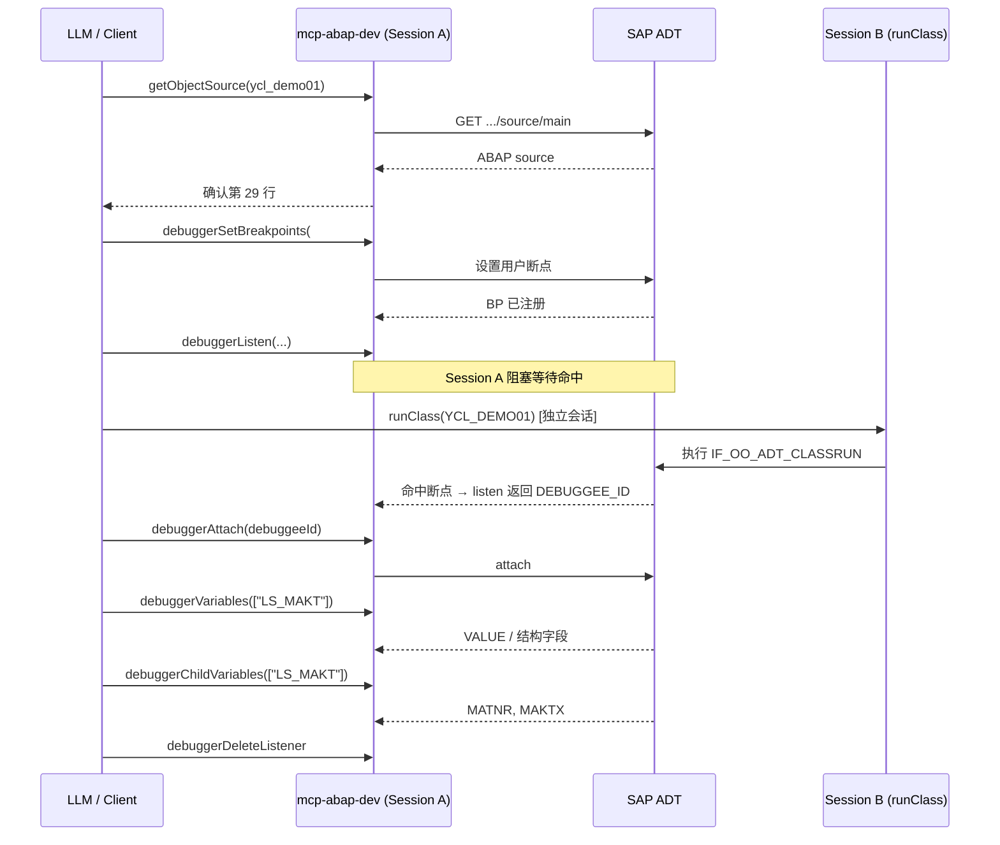

# YCL_DEMO01 第 29 行断点调试：`LS_MAKT` 取值实战文档

> 场景：对类 `YCL_DEMO01` 在 ADT `source/main` **第 29 行**设断点，命中后输出结构变量 `LS_MAKT` 的值。  
> 环境：`mcp-abap-dev`（BKD / client 300）  
> 实测日期：2026-08-05

---

## 1. 场景与源码行号

### 1.1 目标语句（ADT `#start=29`）

```abap
lv_out = |物料编码: { ls_makt-matnr } - 物料描述: { ls_makt-maktx }|.
```

此前 `SELECT ... INTO @DATA(ls_makt)` 已执行完毕，因此断点停在第 29 行**语句前**时，`LS_MAKT` 已有值，一般**不需要**再 `stepOver`。

### 1.2 行号规则（重要）

| 视图 | 是否可用于断点 |
|------|----------------|
| ADT `getObjectSource` → `/source/main` 绝对行号 | ✅ 使用 `#start=29` |
| SE24「基于源代码的类生成器」行号 | ❌ 含 `*<SIGNATURE>` 块，行号会偏移 |

断点 URI 格式：

```text
/sap/bc/adt/oo/classes/ycl_demo01/source/main#start=29
```

---

## 2. 调用链路

### 2.1 正确顺序

```text
healthcheck / login（可选）
    ↓
getObjectSource          ← 确认 #start= 行号
    ↓
debuggerDeleteListener   ← 清理同 terminalId/ideId 的残留 listener（可选）
    ↓
debuggerSetBreakpoints   ← 设置 #start=29
    ↓
┌─────────────────────────────────────────────────────────┐
│  双连接并行（关键）                                       │
│  Session A: debuggerListen（阻塞，等命中）                │
│  Session B: runClass("YCL_DEMO01")（listen 启动后再触发） │
└─────────────────────────────────────────────────────────┘
    ↓
debuggerAttach           ← debuggeeId = listen 返回的 DEBUGGEE_ID
    ↓
debuggerVariables(["LS_MAKT"])
    ↓
debuggerChildVariables(["LS_MAKT"])   ← 展开 MATNR / MAKTX
    ↓
debuggerStep("stepContinue")          ← 放行（可选）
    ↓
debuggerDeleteListener                ← 清理
```

### 2.2 时序图



### 2.3 为何必须双连接

| 问题 | 说明 |
|------|------|
| `debuggerListen` 阻塞 | ADT stateful 会话在 listen 期间不能再发其它请求 |
| 当前 npm MCP 单 client | `mcp-abap-abap-adt-api`（npx）只有一个 `ADTClient` |
| MCP 工具超时 | Cursor 对长时间阻塞的 `debuggerListen` 常报 `Request timed out` |
| `runClass` 时机 | 必须在 **listen 已等待时**触发；放在 `attach` 之后太晚 |

因此实测闭环为：

```text
Session A（stateful ADTClient）：SetBP → Listen → Attach → Variables → DeleteListener
Session B（独立 ADTClient）：sleep(2500) 后 runClass
```

> Cursor 上**最终成功的路径是双 ADTClient 脚本**，不是纯 MCP tool 串行。  
> MCP 仅能稳定完成 `debuggerSetBreakpoints`；`debuggerListen` 常因 Cursor 超时失败，故 listen/attach/读变量改走脚本里的 Session A。

> ❌ 错误顺序：`Listen → Attach → runClass`  
> ✅ 正确顺序：`SetBP → Listen（期间 runClass）→ Attach → Variables`

### 2.4 本次实测结论速览

| 项 | 结果 |
|----|------|
| 断点 | `#start=29` 命中（INCLUDE 相对行 `LINE_CURR=8`） |
| `LS_MAKT-MATNR` | `AWJ003000750` |
| `LS_MAKT-MAKTX` | `硅胶软管3.5*61` |
| `runClass` 输出 | `物料编码: AWJ003000750 - 物料描述: 硅胶软管3.5*61` |
| 读变量方式 | attach 后立刻 `debuggerVariables` + `debuggerChildVariables`，**无** `stepOver` |

### 2.5 Attach 之后如何读 `LS_MAKT`（成功细节）

#### 实际调用（脚本 / `abap-adt-api`）

```js
// attach 之后，同一 Session A，立刻读变量 —— 不要 stepOver
const vars = await a.debuggerVariables(["LS_MAKT"]);
// vars[0].VALUE === "AWJ003000750                            硅胶软管3.5*61"
// vars[0].META_TYPE === "structure"

const kids = await a.debuggerChildVariables(["LS_MAKT"]);
// kids.variables[].NAME: MATNR / MAKTX
```

等价 MCP tool 传参（若 attach 已在 MCP 会话上完成）：

```json
// debuggerVariables —— 字段名是 parents（复数）
{ "parents": ["LS_MAKT"] }

// debuggerChildVariables —— 字段名是 parent（单数）！
{ "parent": ["LS_MAKT"] }
```

#### 参数格式要点（易错）

| 项 | 正确 | 常见错误 |
|----|------|----------|
| 变量名大小写 | `"LS_MAKT"`（运行时大写） | `"ls_makt"` |
| `debuggerVariables` 入参 | MCP：`{ "parents": ["LS_MAKT"] }`；库：`debuggerVariables(["LS_MAKT"])` | 传字符串 `"LS_MAKT"`、或字段名写成 `parent` / `variables` / `name` |
| `debuggerChildVariables` 入参 | MCP：`{ "parent": ["LS_MAKT"] }`；库：`debuggerChildVariables(["LS_MAKT"])` | 写成 `parents`（与 Variables 不一致） |
| 类型 | **string 数组** | 单个 string、或 `{ id: "LS_MAKT" }` |
| 是否先 step | 读 `LS_MAKT`：**不要** `stepOver` | 误以为行断点后变量未赋值 |
| 结构字段 | 先 Variables 看扁平 `VALUE`，再 ChildVariables 拆 `MATNR`/`MAKTX` | 只调 Variables 却期望得到字段对象 |

库签名（`abap-adt-api`）：

```text
debuggerVariables(parents: string[])
debuggerChildVariables(parent: string[] = ["@DATAAGING", "@ROOT"])
```

MCP handler 原样转发：

```text
adtclient.debuggerVariables(args.parents)
adtclient.debuggerChildVariables(args.parent)
```

#### 为何本次不需要 `stepOver`

行断点停在**该行语句执行前**。第 29 行是给 `LV_OUT` 赋值；`LS_MAKT` 已在第 24–28 行 `SELECT`/`ENDSELECT` 填好。

| 变量 | 停在 `#start=29` 时 | 是否需要 stepOver |
|------|---------------------|-------------------|
| `LS_MAKT` | 已有值 | 否 |
| `LV_OUT` | 仍为空（赋值未执行） | 是（先 `stepOver` 再读） |

#### 与「纯 MCP」的差异说明

| 层面 | Cursor 成功路径（脚本） | 若用 MCP tool |
|------|------------------------|---------------|
| attach 后读变量 | `a.debuggerVariables(["LS_MAKT"])` | `debuggerVariables({ parents: ["LS_MAKT"] })` |
| 展开结构 | `a.debuggerChildVariables(["LS_MAKT"])` | `debuggerChildVariables({ parent: ["LS_MAKT"] })` |
| 参数包装 | 直接传 `string[]` | 必须包进 JSON 对象，且 **parents / parent 拼写不同** |
| 会话 | 与 listen/attach **同一** stateful client | 必须仍是 listen/attach 那个 MCP 会话（单 client 时 listen 超时后整条链断） |

> 成功读到 `LS_MAKT` 时，**没有**额外 filter、scope、stack frame URL；attach 成功后当前帧就是 `RUN`，直接按变量名取即可。

### 2.6 `runClass` 触发方式（双连接特殊处理）

`runClass` **本身没有特殊 body/header**，底层就是：

```text
POST /sap/bc/adt/oo/classrun/YCL_DEMO01
```

特殊之处全在**调度与会话**：

| 细节 | 成功做法 | 说明 |
|------|----------|------|
| 独立 Session B | `new ADTClient(...)` 再 `login()` + `runClass()` | 不能占用 Session A（A 卡在 listen） |
| 启动时机 | **先** `a.debuggerListen(...)`（不 await 完之前），B 侧 `sleep(2500)` 再跑 | 保证 listener 已挂上再触发执行 |
| B 是否 stateful | **否**，默认即可 | 只有 A 需要 `a.stateful = session_types.stateful` |
| 用户 | 与断点 `user` **同一 SAP 用户** | `debuggingMode: "user"` 只拦该用户会话 |
| 类名 | `"YCL_DEMO01"`（库内会 `toUpperCase()`） | MCP：`{ "className": "YCL_DEMO01" }` |
| 返回值 | 类 `out->write` 文本；**若 BP 真正挂住 B**，B 会阻塞到 A `stepContinue`/结束 | 成功样例：B 打印 `runClass` 启动 → A listen/attach/读变量 → A `stepContinue` → **之后** B 才打印 returned。总耗时可很短（数秒），关键看**相对顺序**而非绝对秒数 |
| 与 attach 关系 | **禁止** attach 之后再 runClass | 那时执行窗口已过，listen 等不到 |

成功脚本的并发结构（精简）：

```js
// Session A：stateful
a.stateful = session_types.stateful;
await a.login();
await a.debuggerSetBreakpoints(
  "user", terminalId, ideId, clientId,
  ["/sap/bc/adt/oo/classes/ycl_demo01/source/main#start=29"],
  requestUser, "external"
);

// 先启动 B（延迟），再进入阻塞 listen —— 顺序很关键
const bPromise = (async () => {
  await sleep(2500);                    // 给 A 挂 listener 的时间
  const b = new ADTClient(url, user, password, client, language);
  await b.login();                      // B 不必 stateful
  await b.runClass("YCL_DEMO01");       // 无额外参数
})();

const hit = await a.debuggerListen(
  "user", terminalId, ideId, requestUser, true, true
);
// hit.DEBUGGEE_ID（大写字段名）

await a.debuggerAttach("user", hit.DEBUGGEE_ID, requestUser);
const vars = await a.debuggerVariables(["LS_MAKT"]);
const kids = await a.debuggerChildVariables(["LS_MAKT"]);

await a.debuggerStep("stepContinue");   // 放行，B 的 runClass 才能结束
await a.debuggerDeleteListener("user", terminalId, ideId, requestUser);
await bPromise;
```

**不是**特殊处理的部分：

- 没有给 `runClass` 传 debug 标志、terminalId、ideId
- 没有在 B 上设断点
- 没有用 RFC / 外部调试端口；就是普通 HTTP classrun，靠「同用户 + 已注册 external 断点 + A 在 listen」命中

---

## 3. 公共约定参数

以下字段在多个 debugger tool 中复用，**同一调试会话内必须保持一致**。

| 参数 | 类型 | 必填 | 说明 | 本次样例 |
|------|------|------|------|----------|
| `debuggingMode` | string | 是 | 调试模式。用户调试用 `"user"` | `"user"` |
| `terminalId` | string | 是 | 逻辑终端 ID，自拟字符串，标识本次 listener | `"MCP-TERM-YCL-LS3"` |
| `ideId` | string | 是 | IDE 会话 ID，自拟，需与 SetBP/Listen/Delete 一致 | `"MCP-IDE-YCL-LS3"` |
| `clientId` | string | SetBP 必填 | 断点客户端侧 ID，用于区分本次下发的 BP 批次 | `"bp-ycl-ls3"` |
| `user` / `requestUser` | string | 是 | SAP 用户（大写）。监听谁的会话 | `"<SAP_USER>"` |
| `scope` | string | 否 | 断点作用域，外部用户调试常用 `"external"` | `"external"` |

断点 URI 元素：

| 元素 | 说明 |
|------|------|
| `/sap/bc/adt/oo/classes/<name>/source/main` | 类主源码 URL（小写对象名亦可） |
| `#start=<N>` | **ADT source/main 绝对行号**（1-based） |

---

## 4. MCP Tool 接口文档与报文样例

> 调用方式：Cursor MCP `CallMcpTool`，`server = "mcp-abap-dev"`（或配置里的等价名）。  
> 成功时 handler 一般包装为：`{ "status": "success", "result": ... }`。

---

### 4.1 `getObjectSource`

确认断点行号。

**入参**

| 参数 | 类型 | 必填 | 说明 |
|------|------|------|------|
| `objectSourceUrl` | string | 是 | 对象源码 URL |
| `startLine` | number | 否 | 分页起始行 |
| `maxLines` | number | 否 | 分页行数 |

**请求样例**

```json
{
  "objectSourceUrl": "/sap/bc/adt/oo/classes/ycl_demo01/source/main"
}
```

**响应样例（节选）**

```json
{
  "status": "success",
  "source": "CLASS ycl_demo01 DEFINITION\r\n  PUBLIC\r\n  ...\r\n  METHOD run.\r\n    DATA lv_out TYPE string.\r\n    SELECT matnr,maktx INTO @DATA(ls_makt)\r\n     UP TO 1 ROWS\r\n     FROM makt\r\n     WHERE spras = '1'.\r\n    ENDSELECT.\r\n    lv_out = |物料编码: { ls_makt-matnr } - 物料描述: { ls_makt-maktx }|.\r\n    out->write( lv_out ).\r\n  ENDMETHOD.\r\nENDCLASS.\r\n",
  "totalLines": 33,
  "startLine": 1,
  "returnedLines": 33,
  "hasMore": false
}
```

---

### 4.2 `debuggerSetBreakpoints`

**入参**

| 参数 | 类型 | 必填 | 说明 |
|------|------|------|------|
| `debuggingMode` | string | 是 | `"user"` |
| `terminalId` | string | 是 | 与后续 Listen 一致 |
| `ideId` | string | 是 | 与后续 Listen 一致 |
| `clientId` | string | 是 | 本次 BP 客户端 ID |
| `breakpoints` | string[] | 是 | 断点 URI 数组，元素为 `.../source/main#start=N` |
| `user` | string | 是 | SAP 用户 |
| `scope` | string | 否 | 推荐 `"external"` |
| `systemDebugging` | boolean | 否 | 系统调试 |
| `deactivated` | boolean | 否 | 是否停用断点 |
| `syncScupeUrl` | string | 否 | 作用域同步 URL（库拼写） |

**请求样例**

```json
{
  "debuggingMode": "user",
  "terminalId": "MCP-TERM-YCL-LS3",
  "ideId": "MCP-IDE-YCL-LS3",
  "clientId": "bp-ycl-ls3",
  "breakpoints": [
    "/sap/bc/adt/oo/classes/ycl_demo01/source/main#start=29"
  ],
  "user": "<SAP_USER>",
  "scope": "external"
}
```

**响应样例（实测）**

```json
{
  "status": "success",
  "result": [
    {
      "kind": "line",
      "clientId": "bp-ycl-ls3",
      "id": "KIND=0.SOURCETYPE=ABAP.MAIN_PROGRAM=YCL_DEMO01====================CP.INCLUDE=YCL_DEMO01====================CM001.LINE_NR=8",
      "nonAbapFlavour": "",
      "uri": {
        "range": {
          "start": { "line": 29, "column": 0 },
          "end": { "line": 29, "column": 0 }
        },
        "uri": "/sap/bc/adt/oo/classes/ycl_demo01/source/main",
        "query": {},
        "hashparms": {}
      },
      "type": "CLAS/OC",
      "name": "YCL_DEMO01"
    }
  ]
}
```

说明：`id` 里的 `LINE_NR=8` 是 **INCLUDE（方法实现）内相对行**；`uri.range.start.line=29` 才是 `source/main` 绝对行。

---

### 4.3 `debuggerListen`

阻塞等待断点命中。返回中的 `DEBUGGEE_ID` 供 `debuggerAttach` 使用。

**入参**

| 参数 | 类型 | 必填 | 说明 |
|------|------|------|------|
| `debuggingMode` | string | 是 | `"user"` |
| `terminalId` | string | 是 | 与 SetBP 一致 |
| `ideId` | string | 是 | 与 SetBP 一致 |
| `user` | string | 是 | SAP 用户 |
| `checkConflict` | boolean | 否 | 是否检查冲突 |
| `isNotifiedOnConflict` | boolean | 否 | 冲突时是否通知 |

**请求样例**

```json
{
  "debuggingMode": "user",
  "terminalId": "MCP-TERM-YCL-LS3",
  "ideId": "MCP-IDE-YCL-LS3",
  "user": "<SAP_USER>",
  "checkConflict": true,
  "isNotifiedOnConflict": true
}
```

**响应样例（实测命中）**

```json
{
  "CLIENT": 300,
  "DEBUGGEE_ID": "0DF901440B211FD1A495930B8CA97A14",
  "TERMINAL_ID": "",
  "IDE_ID": "",
  "DEBUGGEE_USER": "<SAP_USER>",
  "PRG_CURR": "YCL_DEMO01====================CP",
  "INCL_CURR": "YCL_DEMO01====================CM001",
  "LINE_CURR": 8,
  "DBGEE_KIND": "DEBUGGEE",
  "IS_ATTACH_IMPOSSIBLE": false,
  "APPSERVER": "sapbkd-app.bak.com.cn",
  "IS_SAME_SERVER": true,
  "INSTANCE_NAME": "sapbkd-app_BKD_00",
  "URI": {
    "range": {
      "start": { "line": 29, "column": 0 },
      "end": { "line": 29, "column": 0 }
    },
    "uri": "/sap/bc/adt/oo/classes/ycl_demo01/source/main",
    "query": {},
    "hashparms": {}
  },
  "TYPE": "CLAS/OC",
  "NAME": "YCL_DEMO01"
}
```

关键字段：

| 字段 | 含义 |
|------|------|
| `DEBUGGEE_ID` | 传给 `debuggerAttach.debuggeeId` |
| `URI.range.start.line` | 命中绝对行（29） |
| `LINE_CURR` | INCLUDE 内相对行（8） |
| `IS_ATTACH_IMPOSSIBLE` | 为 `true` 时无法 attach |

---

### 4.4 `runClass`（触发执行，建议独立会话）

执行实现了 `IF_OO_ADT_CLASSRUN` 的类。

**入参**

| 参数 | 类型 | 必填 | 说明 |
|------|------|------|------|
| `className` | string | 是 | 类名，如 `YCL_DEMO01` |

**请求样例**

```json
{
  "className": "YCL_DEMO01"
}
```

**响应样例（实测）**

```json
{
  "status": "success",
  "result": "物料编码: AWJ003000750 - 物料描述: 硅胶软管3.5*61\n\n"
}
```

> 注意：在 listen 阻塞期间，应使用**第二条 ADT 连接**调用 `runClass`。串行地在同一 MCP client 上「先 listen 再 runClass」会失败或超时。  
> 触发调度细节见 **§2.6**（延迟、同用户、B 不必 stateful、无特殊 body）。

---

### 4.5 `debuggerAttach`

**入参**

| 参数 | 类型 | 必填 | 说明 |
|------|------|------|------|
| `debuggingMode` | string | 是 | `"user"` |
| `debuggeeId` | string | 是 | listen 返回的 `DEBUGGEE_ID` |
| `user` | string | 是 | SAP 用户 |
| `dynproDebugging` | boolean | 否 | 是否 Dynpro 调试 |

**请求样例**

```json
{
  "debuggingMode": "user",
  "debuggeeId": "0DF901440B211FD1A495930B8CA97A14",
  "user": "<SAP_USER>"
}
```

**响应样例（实测，节选）**

```json
{
  "isRfc": false,
  "isSameSystem": true,
  "serverName": "sapbkd-app_BKD_00",
  "debugSessionId": "0DF901440B211FD1A495930F82281A16",
  "processId": 39266,
  "isPostMortem": false,
  "isSteppingPossible": true,
  "isTerminationPossible": true,
  "stepSizeMode": "LINE",
  "sessionTitle": "HTTP session: sapbkd-app_BKD_00",
  "reachedBreakpoints": [
    {
      "id": "KIND=0.SOURCETYPE=ABAP.MAIN_PROGRAM=YCL_DEMO01====================CP.INCLUDE=YCL_DEMO01====================CM001.LINE_NR=8",
      "kind": "line",
      "unresolvableCondition": "",
      "unresolvableConditionErrorOffset": ""
    }
  ]
}
```

---

### 4.6 `debuggerVariables`

读取当前栈帧变量。

**入参**

| 参数 | 类型 | 必填 | 说明 |
|------|------|------|------|
| `parents` | string[] | 是 | 变量名数组（ABAP 名，通常大写） |

**请求样例**

```json
{
  "parents": ["LS_MAKT"]
}
```

**响应样例（实测）**

```json
[
  {
    "ID": "LS_MAKT",
    "NAME": "LS_MAKT",
    "DECLARED_TYPE_NAME": "Type %_##OSQLC_0 in Method RUN in YCL_DEMO01",
    "ACTUAL_TYPE_NAME": "Type %_##OSQLC_0 in Method RUN in YCL_DEMO01",
    "META_TYPE": "structure",
    "VALUE": "AWJ003000750                            硅胶软管3.5*61",
    "TECHNICAL_TYPE": "Structure: flat, charlike",
    "LENGTH": 160,
    "TABLE_LINES": 0
  }
]
```

---

### 4.7 `debuggerChildVariables`

展开结构/对象子字段。

**入参**

| 参数 | 类型 | 必填 | 说明 |
|------|------|------|------|
| `parent` | string[] | 否 | 父变量名数组，如 `["LS_MAKT"]` |

> 注意：tool schema 字段名是 `parent`（不是 `parents`）。

**请求样例**

```json
{
  "parent": ["LS_MAKT"]
}
```

**响应样例（实测）**

```json
{
  "hierarchies": [
    { "PARENT_ID": "LS_MAKT", "CHILD_ID": "LS_MAKT-MATNR", "CHILD_NAME": "" },
    { "PARENT_ID": "LS_MAKT", "CHILD_ID": "LS_MAKT-MAKTX", "CHILD_NAME": "" }
  ],
  "variables": [
    {
      "ID": "LS_MAKT-MATNR",
      "NAME": "MATNR",
      "DECLARED_TYPE_NAME": "MATNR",
      "META_TYPE": "simple",
      "VALUE": "AWJ003000750                            ",
      "TECHNICAL_TYPE": "C",
      "LENGTH": 40
    },
    {
      "ID": "LS_MAKT-MAKTX",
      "NAME": "MAKTX",
      "DECLARED_TYPE_NAME": "MAKTX",
      "META_TYPE": "simple",
      "VALUE": "硅胶软管3.5*61                              ",
      "TECHNICAL_TYPE": "C",
      "LENGTH": 40
    }
  ]
}
```

**取值结论**

| 字段 | 值（trim 后） |
|------|----------------|
| `LS_MAKT-MATNR` | `AWJ003000750` |
| `LS_MAKT-MAKTX` | `硅胶软管3.5*61` |

---

### 4.8 `debuggerStep`

**入参**

| 参数 | 类型 | 必填 | 说明 |
|------|------|------|------|
| `steptype` | string | 是 | 步进类型，见下表 |
| `url` | string | 否 | `stepRunToLine` / `stepJumpToLine` 时需要目标行 URI |

常用 `steptype`：

| 值 | 含义 |
|----|------|
| `stepOver` | 单步越过 |
| `stepInto` | 单步进入 |
| `stepReturn` | 单步返回 |
| `stepContinue` | 继续运行 |
| `stepRunToLine` | 运行到指定行（需 `url`） |
| `stepJumpToLine` | 跳到指定行（需 `url`） |

**请求样例（放行）**

```json
{
  "steptype": "stepContinue"
}
```

若断点停在「赋值前」且要读赋值后的标量（如 `LV_OUT`），可先：

```json
{
  "steptype": "stepOver"
}
```

再 `debuggerVariables(["LV_OUT"])`。本次读 `LS_MAKT` 无需 `stepOver`。

---

### 4.9 `debuggerDeleteListener`

**入参**

| 参数 | 类型 | 必填 | 说明 |
|------|------|------|------|
| `debuggingMode` | string | 是 | `"user"` |
| `terminalId` | string | 是 | 与 Listen 一致 |
| `ideId` | string | 是 | 与 Listen 一致 |
| `user` | string | 是 | SAP 用户 |

**请求样例**

```json
{
  "debuggingMode": "user",
  "terminalId": "MCP-TERM-YCL-LS3",
  "ideId": "MCP-IDE-YCL-LS3",
  "user": "<SAP_USER>"
}
```

**响应样例**

```json
{
  "status": "success"
}
```

---

### 4.10 辅助 Tool（可选）

#### `debuggerListeners`

列出当前 listener，排查冲突。

```json
{
  "debuggingMode": "user",
  "terminalId": "MCP-TERM-YCL-LS3",
  "ideId": "MCP-IDE-YCL-LS3",
  "user": "<SAP_USER>",
  "checkConflict": true
}
```

#### `debuggerDeleteBreakpoints`

删除单个断点；`breakpoint` 传 SetBP 返回的对象（含 `id` / `uri` 等）。

#### `healthcheck`

```json
{}
```

响应：

```json
{
  "status": "healthy",
  "timestamp": "2026-08-05T09:01:20.480Z"
}
```

---

## 5. LLM 调用 MCP 时参数如何传

Cursor Agent 侧等价于：

```text
CallMcpTool
  server   = "user-mcp-abap-dev"   // 或 mcp-abap-dev
  toolName = "debuggerSetBreakpoints"
  arguments = { ...上表 JSON... }
```

原则：

1. **只传 `inputSchema` 里声明的字段**，不要塞 HTTP header / CSRF。
2. **`terminalId` / `ideId` / `user` 全链路同一套**。
3. **断点用 URI 字符串**，不是 `{ line: 29 }` 对象。
4. **变量名用 ABAP 运行时大写**（`LS_MAKT`，不是 `ls_makt`）。
5. **结构字段**先 `debuggerVariables`，再 `debuggerChildVariables`。
6. **`debuggeeId` 原样透传** listen 的 `DEBUGGEE_ID`，不要截断。
7. **MCP 字段名不一致**：Variables 用 `parents`，ChildVariables 用 `parent`；底层都是 `string[]`。
8. **读 `LS_MAKT` 不要 `stepOver`**；读同行赋值目标（如 `LV_OUT`）才需要。
9. **`runClass` 必须独立会话 + listen 已挂起后触发**（见 §2.6），不要放在 attach 之后。

伪代码：

```js
// 1) 设断点
await mcp.debuggerSetBreakpoints({
  debuggingMode: "user",
  terminalId, ideId, clientId,
  breakpoints: ["/sap/bc/adt/oo/classes/ycl_demo01/source/main#start=29"],
  user: "<SAP_USER>",
  scope: "external",
});

// 2) 并行：A listen，B runClass
const listenP = mcp.debuggerListen({
  debuggingMode: "user", terminalId, ideId, user: "<SAP_USER>",
  checkConflict: true, isNotifiedOnConflict: true,
});
await sleep(2500);
const runP = otherSession.runClass("YCL_DEMO01"); // 必须另一条 ADT 连接
const hit = await listenP; // { DEBUGGEE_ID, URI, ... }

// 3) attach + 读变量
await mcp.debuggerAttach({
  debuggingMode: "user",
  debuggeeId: hit.DEBUGGEE_ID,
  user: "<SAP_USER>",
});
const vars = await mcp.debuggerVariables({ parents: ["LS_MAKT"] });
const kids = await mcp.debuggerChildVariables({ parent: ["LS_MAKT"] });

// 4) 清理
await mcp.debuggerStep({ steptype: "stepContinue" });
await mcp.debuggerDeleteListener({
  debuggingMode: "user", terminalId, ideId, user: "<SAP_USER>",
});
```

---

## 6. 已知限制与排障

| 现象 | 原因 / 处理 |
|------|-------------|
| MCP `debuggerListen` → `Request timed out` | Cursor MCP 调用超时短于 ADT listen 等待；用双会话脚本或本地拉长超时 |
| `debuggerListen` → HTTP 400 | 残留 listener / 会话状态异常；换新的 `terminalId`+`ideId`，或先 `debuggerDeleteListener` |
| SetBP 成功但从不命中 | `runClass` 未在 listen 等待期间触发；或 `user`/`scope` 不一致 |
| 读到空结构 | 断点打在 `SELECT` 之前；或停在错误行（SE24 行号误用） |
| Variables 报错 / 空结果 | 传了字符串而非数组；字段名写成 `parent`/`name`；变量名小写 |
| ChildVariables 无字段 | MCP 误用 `parents`（应写 `parent`）；或未先 attach |
| `LV_OUT` 为空但 `LS_MAKT` 有值 | 正常：同行断点停在赋值前；对 `LV_OUT` 需先 `stepOver` |
| `login` MCP 报 content schema 错 | npm 包 `login` 返回格式问题；`healthcheck` / 其它 tool 仍可用 |
| 单 MCP 串行 `Listen → runClass` | 单 client 阻塞，不可行 |
| attach 后再 `runClass` | 太晚，listen 已结束或等不到；必须 listen 期间触发 |
| Listen/Attach 都成功，但 Variables「出现异常」，且 B 的 `runClass` 很快返回完整结果 | **高度怀疑挂住的不是 B 那个进程**：listen 可能命中同用户其它会话/残留 debuggee，或 attach 后会话已死。判定：看 B 是否在 A 的 `stepContinue` **之后**才 returned；若 Variables 失败时 B 早已跑完，则 BP 未挂住 B |
| 子代理跑 `runClass`、主会话 MCP 跑 Listen/Attach | 可行（本质双连接），但必须：同一 `user`、Listen **先进入阻塞**、子代理再触发；Attach 后的 Variables **必须仍在 Listen/Attach 同一 MCP client/stateful 会话**上调用 |
| **纯 MCP 组合复现（2026-08-05 Cursor 实测）** | SetBP/Listen/Attach ✅ → Variables/Stack ❌「出现异常」→ Step ❌「Data is invalid」；子代理 `runClass` 返回完整 WRITE。与 Claude Code 现象一致。**根因倾向：子代理 `runClass` 打到同一 `mcp-abap-dev` 进程的同一个 `ADTClient`，与 Listen/Attach 的 stateful 调试会话互相踩踏**；双 `ADTClient` 脚本则 A/B 隔离故成功 |
| 跨 tool-call 拆 Listen / Attach / Variables | Cursor 分次调用后调试会话态易失效。**改用原子工具 `debuggerListenAttachVariables`**：同一 handler 内连续 `Listen→Attach→Variables`（可选 `childParents` / `continueAfter`） |

---

## 7. 完整闭环报文清单（本次成功）

| 步骤 | Tool | 关键入参 | 关键出参 |
|------|------|----------|----------|
| 1 | `debuggerSetBreakpoints` | `#start=29` | `uri.range.start.line=29` |
| 2 | `debuggerListen` + 并行 `runClass` | 同一 `terminalId/ideId` | `DEBUGGEE_ID=0DF90144...7A14` |
| 3 | `debuggerAttach` | 上一步 `DEBUGGEE_ID` | `debugSessionId` / `reachedBreakpoints` |
| 4 | `debuggerVariables` | `["LS_MAKT"]` | `VALUE` 含物料号与描述 |
| 5 | `debuggerChildVariables` | `["LS_MAKT"]` | `MATNR` / `MAKTX` |
| 6 | `debuggerStep` + `debuggerDeleteListener` | `stepContinue` | 会话结束 |

---

## 8. 相关对象

| 项 | 值 |
|----|-----|
| 类 | `YCL_DEMO01` |
| 接口 | `IF_OO_ADT_CLASSRUN` |
| 方法 | `RUN` |
| 源码 URL | `/sap/bc/adt/oo/classes/ycl_demo01/source/main` |
| MCP Server | `mcp-abap-dev` |
| 调试用户 | `<SAP_USER>` |
